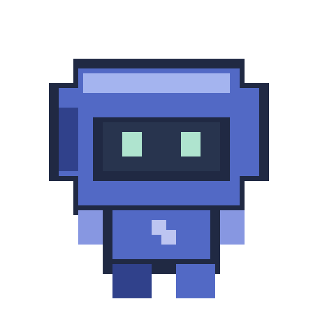

<p align="center"></p>
<h1 align="center">Pixelito · Pixel Desktop</h1>
<p align="center">Um pequeno colega de trabalho que mora na sua tela. Para macOS e Windows.</p>

## Baixar

**[Baixar a versão mais recente](https://github.com/lucasfevianaaa/pixel-desktop/releases/latest)**

| Seu computador | Arquivo |
| --- | --- |
| Mac com Apple Silicon (M1, M2, M3, M4…) | `Pixel-5.1.1-mac-arm64.dmg` |
| Mac com Intel | `Pixel-5.1.1-mac-x64.dmg` |
| Windows de 64 bits | `Pixel-5.1.1-win-x64.exe` |

No Mac, abra o DMG e arraste **Pixel** para Aplicativos. No Windows, execute o instalador e use o atalho **Pixel**. Não é preciso instalar Node.js ou criar conta no ElevenLabs.

Esta distribuição inicial não tem certificado comercial de assinatura/notarização. macOS e Windows podem apresentar avisos sobre o editor não verificado. Não desative as proteções do sistema. O código e os checksums acompanham cada versão. Os builds Windows são gerados em Windows; a conferência visual manual foi realizada no Mac.

## Brinque e personalize

- **Botão direito no mascote → Configurações do Pixel:** prévia ao vivo, aparência, personalidade, voz, volumes, território e perfis.
- **Arraste** o personagem para mudar de lugar. Ele pode reagir como se estivesse mudando de escritório.
- Aproxime devagar da **mão** para uma carona visual. Durante a carona, os cliques continuam chegando ao aplicativo abaixo.
- **Cuidar e brincar:** café, biscoito, carinho, elogio, reunião com pato, portal e outras cenas.
- Cliques geram reações cartunescas ao chicote. Você pode desligar o chicote, as reações e cada brincadeira.
- Perfis **Trabalho**, **Resenha**, **Gravação** e **Companhia**. Gravação restaura o perfil anterior quando você sai dele.

| Ação | Mac | Windows |
| --- | --- | --- |
| Conversar | ⌘⇧P | Ctrl+Shift+P (texto/comandos) |
| Mostrar / ocultar | ⌘⇧M | Ctrl+Shift+M |
| Chamar até o cursor | ⌘⇧J | Ctrl+Shift+J |

O menu da barra do sistema também permite mostrar o personagem, inclusive quando ele estiver oculto. Nenhum painel fica permanentemente sobre a área de trabalho.

### Visual de estreia

A versão compartilhada inclui os ajustes escolhidos pelo criador: nome **Pixelito**, tamanho **1×**, azul, tema escritório, acessórios, mais curiosidade, energia e drama, perfil Resenha. Todos podem ser alterados. A restauração dos padrões continua disponível. Inicialização automática vem desligada para quem instalar pela primeira vez.

### Voz

25 falas expressivas em português (incluindo 16 novas) foram produzidas no ElevenLabs e acompanham o aplicativo. Os nomes dos arquivos e as falas públicas não usam o nome pessoal do criador. Não há chaves ou identificadores da conta dentro do projeto.

O áudio é reproduzido localmente no Mac e no Windows. Em Voz e sons, você pode escolher e ouvir todas as gravações. Novas reações aguardam a frase atual terminar; silenciar interrompe imediatamente. Frases personalizadas sem gravação podem usar a voz em português instalada no sistema; a qualidade depende das vozes disponíveis no computador. Voz, efeitos sonoros e balões têm controles separados. Nenhuma chamada paga de geração é feita pelo aplicativo.

## Conversa local opcional

Converse por texto ou microfone, com reconhecimento em português, respostas locais e voz baseada no Pixel. O visual atual é preservado. O motor de IA desta versão é para **Mac com Apple Silicon e macOS 26**; exige instalação separada e download dos modelos. As vozes gravadas e o mascote continuam funcionando também no Windows e Mac Intel.

Veja **[instalação e limites da conversa local](docs/LOCAL-ASSISTANT.md)**. Não é uma integração com a conta do ChatGPT nem o modelo Eleven v4 offline.

## Atividades reais do chat

A integração opcional recebe eventos locais dos hooks. Ela não lê conversas, não mostra porcentagens inventadas e não acompanha ferramentas que não emitem eventos compatíveis.

Veja **[como configurar os hooks](docs/INTEGRATION.md)**. É necessário Python 3 e revisar/confiar no comando no aplicativo que oferece os hooks. Sem essa configuração, o mascote continua funcionando normalmente.

## Privacidade

As configurações ficam no computador:

- Mac: `~/Library/Application Support/Pixel/`
- Windows: `%APPDATA%\Pixel\`

Perfis exportados contêm apenas preferências. O bridge de eventos descarta prompts, respostas e argumentos; guarda tipo do evento, nome da ferramenta, horário e um hash curto de sessão. A detecção do ChatGPT consulta nomes de processos, sem capturar tela, teclado ou conteúdo das janelas. O código não faz telemetria nem solicita credenciais.

## Desenvolver

Requer Node.js 24 e npm.

```sh
npm ci
npm test
npm start
```

```sh
npm run build:mac
npm run build:win
```

O empacotamento usa Electron e electron-builder com versões fixadas no lockfile. No GitHub Actions, `Build Pixel` testa e gera os pacotes em macOS/Windows. Uma tag `v*` publica os arquivos na página Releases após ambos os builds passarem. O workflow usa permissão de escrita apenas no job de publicação.

## Licenças

Código e pixel art: [MIT](LICENSE). Áudios: [condições dos arquivos de mídia](MEDIA-LICENSE.txt). Pixelito é um projeto independente e não é um produto oficial da OpenAI, GitHub ou ElevenLabs.
